# Rendering Flow

## Terms

| Term | Meaning |
|----|----|
| Laptop (host) | Builds the scene, sends it to the chip and saves the image. |
| Arrow/Vector | A 3D vector: three numbers x, y and z, called its parts. It is a direction or a distance in space. |
| UART | Universal asynchronous receiver-transmitter: a serial link that sends one bit at a time. Each byte takes 10 bits: a start bit, 8 data bits and a stop bit. |
| Baud | UART speed in bits per second, for example 115,200. |
| OBJECT, RENDER, PIXEL | The three UART messages (docs uart_frame.md). OBJECT writes one SRAM word. RENDER starts the render; it carries an image size, but the chip draws 512 × 512 only. PIXEL carries one finished pixel back: a start byte, then R, G and B. |
| DLE | Data link escape: the byte 0x03. The sender puts it before any data byte that equals a start byte (0x00 RENDER or PIXEL, 0x01 OBJECT) or 0x03 (docs uart_frame.md). |
| SRAM | Static random-access memory: the on-chip memory, 512 words of 16 bits. It holds the scene and is read-only during a render. |
| Header | SRAM words 0–16: camera arrows, sky and ground colours, BV count, samples per pixel and camera height (Level 2). |
| w0, w1 … | Word 0, word 1 … of one SRAM record. |
| I/O Unit | Input/output unit. It talks to the laptop over the UART and writes the scene into the SRAM. |
| RTU | Ray Tracing Unit. It runs the ray tracing steps and decides what to compute next. Its parts are the Controller, Ray Generator, Intersection Unit and Shader Core (Level 2). |
| Controller | Part of the RTU. It runs the pixel, sample and bounce loops. |
| Ray Generator | Part of the RTU. It holds O and D, and makes the camera ray and each new direction after a bounce. |
| Intersection Unit | Part of the RTU. It only computes intersections: it finds the first thing a ray hits and exports the distance t, the object address and the flip bit. Of each object it reads the test words and the type bit in w0, never the colour words. |
| Shader Core | Part of the RTU. It reads the hit object's colour words (w0–w2) and works out the colours. |
| Accumulator | Adds up the samples of one pixel and makes the pixel colour. |
| Opcode | Operation code: the number that picks the operation. |
| Macro-op | One RTU request, for example "add two arrows": a 5-bit opcode and up to six 16-bit numbers. Names start with M_ (M_ADD, M_NORM …); the full list is under Macro-ops. |
| Request field | One of the six 16-bit numbers of a request: u.x, u.y, u.z, v.x, v.y, v.z. u and v are the two input arrows (docs names). |
| Decode Unit | Splits a macro-op into micro-ops, runs them on the units and returns the result. |
| Micro-op | One single-number operation. It reads two registers and writes one. |
| Register File | R0–R7: eight 16-bit registers used by the current macro-op. |
| FU | Functional unit: the ALU (arithmetic logic unit: add, subtract, compare), the multiplier or the CORDIC unit. |
| FU Control | Starts the functional units and writes their results into the Register File. |
| CORDIC | Coordinate rotation digital computer: a unit that computes cos, length, divide and square root with shifts and adds only. |
| Valid / ready | Handshake: a transfer happens in a cycle where both signals are high. |
| Cycle | One clock period: 40 ns at 25 MHz. |
| Sample | One ray path from the camera through a pixel, bounces included. A pixel is the average of s samples, s = 1, 2, 4, 8, 16 or 32. |
| Segment | One straight piece of a path, from its start to the first thing it hits. Costs are given per segment. |
| Bounding volume (BV) | A sphere around a few nearby objects. If the ray cannot reach it, the chip skips all its objects. Up to 16. |
| Reach, skip | The two answers of a BV test: the ray can touch the BV (test its objects), or it cannot (skip them). |
| t | Distance along the ray from its start to a hit. |
| Out-arrow n | Length-1 arrow straight out of the surface at the hit point. |
| K | Per-object size shift (5 bits, signed) that keeps squares and products under 256 (5d, 5e). Right shifts round; left shifts clamp. |
| _s | A name that ends in _s is the value after the K shift: r_s is the radius shifted by K. |
| Leading-one finder | Finds the highest 1 bit of a value. It picks K and the resize shift. |
| Flag | 1-bit compare result returned to the RTU. |
| Flip bit | 1 bit kept with the best hit: 1 if the ray starts inside the sphere (glass), or meets the back side of the triangle. |
| Attenuation (att) | Light the path still carries, 8 bits per colour; 255 = all of it. |
| F, R, U | Camera arrows: forward to the screen centre, right and up. They are in the header. |
| Header registers | RTU copies of the 17 header words, read once when RENDER arrives. |
| Kept test values | What the search keeps for the closest hit so far: t, address, type bit, flip bit and, for a triangle, K. |
| LFSR | Linear-feedback shift register: a 16-bit shift register whose new bits are XORs of some of its bits. It gives random-looking numbers (docs [rng.md](http://rng.md)). |
| Resize | Scale an arrow to length 1. |
| Push off | Move a new start 0.031 off the surface, so that the next ray cannot hit the same surface again at once. |
| Clamp | Replace a result that is too big for 16 bits with 0x7FFF, or with 0x8000 if it is negative. The ALU add and subtract, the multiplier (after its shift), the K shifter (left shifts) and the CORDIC divide, 1 ÷ x and length all clamp. A compare uses the true sign of a − b. |

## Number formats

**The chip has no floating point**.

 A fixed-point number is a 16-bit integer, the raw value, read with a fixed binary point. 

Qm.n means m bits before the binary point (sign included) and n bits after it, so the value is raw ÷ 2^n. 


We have 2 main formats:

POS (position format, Q9.7): value = raw ÷ 128. 

DIR (direction format, Q2.14): value = raw ÷ 16,384. 

Using these formats allows us to encode the scene at high fidelity while also having our vectors be sufficiently precise.

A multiply of two 16-bit numbers gives a 32-bit product; "shift n" below means the product is shifted right by n bits, with rounding, to give 16 bits.

These tables are a reference. Each symbol is defined in the section where it is first computed: O, D, a, b in 5a; C, along, M, offset in 5c; half in 5d; v0, e1, e2, α, β, slid, det in 5e; r, z, w, ρ, φ, η in 5g.

| Format | Bits | Range, step | Used for |
|----|----|----|----|
| POS (position, Q9.7) | 16 signed | ±256, step 1/128 | positions O, C, v0; radius; edges; t; along; offset; slid; det, α_top, β_top; camera z |
| DIR (direction, Q2.14) | 16 signed | ±2, step 1/16384 | D, n, F, R, U; a, b; random arrow r, z, w, ρ; φ in radians; cosines; α, β; 1 ÷ length; constants η, 0.04, 0.96, π/2 |
| Product | 32 signed | inside the multiplier only | shifted back to 16 bits (next table), then clamped |
| Colour | 8 unsigned | 0 … 255 | object, sky and ground colours; attenuation (255 = 1.0) |
| Strength (Q4.10) | 14 unsigned | 0 … 15.99, step 1/1024 | glow strength (1024 = 1.0) |
| Sample / sum / pixel | 12 / 17 / 8 unsigned | 0 … 4080 / … / 0 … 255 | Shader Core sample register, Accumulator, UART |
| Integers | 1 … 9 | — | address 9, count 7, K 5 signed, pixel x and y 9 each, sample count 5, bounce 4, material 2, type 1, flags 1 |

| Where formats meet | Rule | Examples |
|----|----|----|
| POS × POS | shift 7 → POS | \|offset\|², r², det, α_top |
| POS × DIR | shift 14 → POS | along, t × D, 0.031 × n, P = D × e2 |
| DIR × DIR | shift 14 → DIR | a × R, D · n, φ = w × π/2 |
| POS ÷ POS · POS ÷ DIR · DIR ÷ DIR | (a ≪ 14) ÷ b As it turns out, always shift by 14 in division | α = α_top ÷ det |
| √ | fmt = 0: CORDIC: shift input right by 7, then shift output left by 7  fmt = 1: CORDIC: shift input right by 14, then shift output left by 14 | half chord; glass √k; matte ρ |
| cos | DIR radians, \|angle\| ≤ 1.743 rad (about 99.8°, docs) → DIR | cos φ, cos(φ − π/2) |
| +, −, compare | same format on both sides | t = along + α (e1 · D) + β (e2 · D) |
| shift by K · resize pre-shift | POS stays POS; K > 0 shifts right and rounds, K < 0 shifts left and clamps · any arrow → DIR | offset, r, slid, edges · cross product → n |
| sign flip | XOR every bit with one control bit: 1 gives −a − 1 step (two's complement), 0 gives a; no adder | ±ρ cos φ, ±ρ sin φ (random sign bits) |
| exact negate | flip every bit, then add 1: −a exactly (a small + 1 circuit) | −D_z (ground t) |
| colour | part by part ≫ 8 (M_VMUL); × strength ≫ 10 | attenuation, sample |
| wiring | bits placed, no maths | a, b from pixel bits; z, w from LFSR bits; checker = bit 9 |
| sample → pixel | sum ≫ log₂ s, clamp 255 | Accumulator |


## Overview: Full render flow

Rendering flow is as follows:

| # | Block | What happens |
|----|----|----|
| 1 | Laptop → I/O Unit → SRAM | Write the header, the bounding volumes and the objects (at most 512 words) with OBJECT messages. |
| 2 | I/O Unit → Controller | RENDER message (the chip draws 512 × 512 only). The Controller reads the 17 header words once into the header registers (17 × 2 = 34 cycles). |
| 3 | Ray Generator | Per sample, make the camera ray: a, b from the pixel bits and 6 random bits; D = resize(F + a × R + b × U); O = (0, 0, camera z). The Controller sets bounce = 0. (5a, 5b) |
| 4 | Intersection Unit: BVs | Test each bounding volume: read its w1–w4. Start inside → reach; centre behind → skip; ray passes closer than r → reach. After a reach, read w0 (where its objects are). (5c) |
| 5 | Intersection Unit: objects | For each object of a reached BV: read w0; the type bit picks sphere or triangle; the next object starts 7 or 12 words later. |
| 6 | Sphere | Find t (5d). If t < best t: keep t, the address, the type bit and the flip bit. |
| 7 | Triangle | Find t in four stages (5e). If t < best t: keep t, the address, the type bit, the flip bit and K. |
| 8 | Ground | Only if no object was hit and the ray points down (D_z < 0): t = O_z ÷ (−D_z), where −D_z is D_z with every bit flipped, plus 1. If the divide clamps (t = 0x7FFF), the ground is too far: sky. (Level 4) |
| 9 | Intersection Unit: winner | Object or ground hit: make the hit point H = O + t × D and n (5f). Then pulse done. |
| 10 | Shader Core: sky | Its first start of a sample (new_sample = 1) sets att = 255. Nothing hit: sample from the sky colours and D_z (5h). Path ends. |
| 11 | Shader Core: object | Read w0–w2 (colour, material, glow strength) at the address the Intersection Unit exports. Glow material: sample from c and strength (5h). Path ends. |
| 12 | Shader Core: surface | Bounce 8 reached → sample = 0, path ends. Else att = att × (c + 1) ≫ 8. |
| 13 | Ray Generator: bounce | New direction by material, from D and n. New start O = H ± 0.031 × n. Back to step 4. (5g) |
| 14 | Controller → Accumulator | Path ended (path_end = 1): send the sample, wait for ready, then start the next sample at step 3. |
| 15 | Accumulator → I/O Unit | Add the s samples; pixel = sum ≫ log₂ s, clamped to 255 → PIXEL message on the UART. |

## Highest Level

The laptop sends the scene once, then one render command; the chip returns one pixel at a time.

 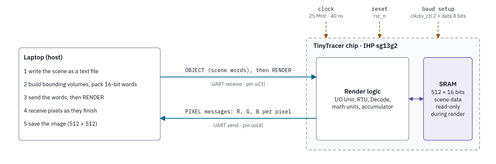

*The laptop prepares the scene once, before the render. The chip stores it in the 512-word SRAM, reads it only while rendering, and streams each pixel back when done. Clock, reset and baud setup come from the board that holds the chip. rst_n is the reset input: the chip resets while it is 0. Baud setup: two I/O Unit inputs, clkdiv_ctl (2 bits) and clkdiv_data (8 bits), load the clock-divider settings b and c that set the UART speed (docs [io.md](http://io.md); the docs pin list gives them no pins yet). ui\[3\] and uo\[4\] are TinyTapeout input pin 3 and output pin 4 (docs info.yaml).*

## Block Diagram

The RTU decides the ray tracing steps. It does no 16-bit arithmetic itself, only counters, shifts and sign flips. For each calculation it sends a macro-op to the Decode Unit. The Decode Unit runs micro-ops on the ALU, the multiplier and the CORDIC unit, and it returns three 16-bit numbers.

 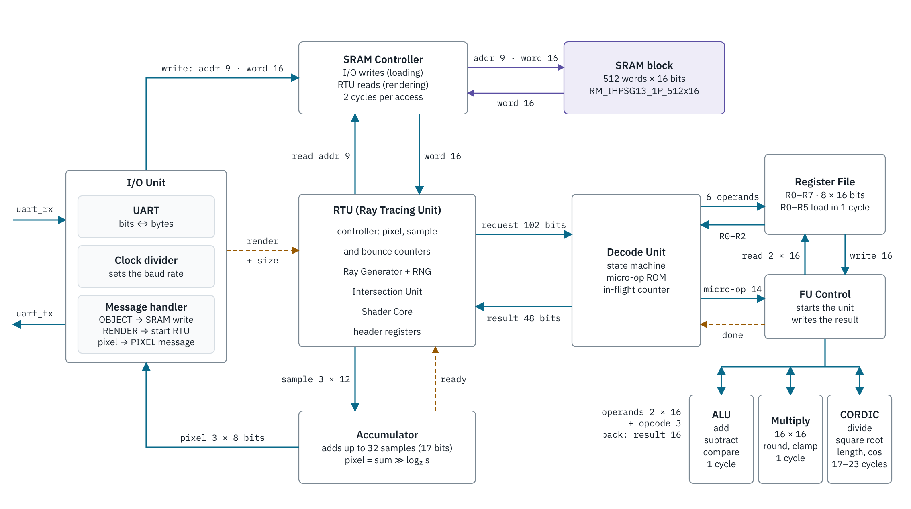


\
*Level 1. Block names from the docs. Solid lines carry numbers (width in bits on the line); dashed lines carry control signals. The SRAM block is a ready-made memory from the chip maker (RM_IHPSG13_1P_512x16). The in-flight counter counts the micro-ops that are still running (docs [decode.md](http://decode.md)).*

Request: 102 bits: 5-bit opcode, six 16-bit numbers and 1 format bit for the multiply shift: 0 = shift 7, 1 = shift 14 (Number formats). Colour multiplies use format 0, then drop result bits to reach shifts 8 and 10 (5h). K is applied in the Intersection Unit and never reaches Decode. Micro-op: 13 bits plus the same format bit.

### What the SRAM holds

 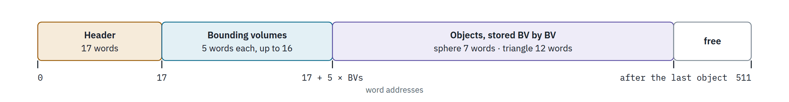

*Memory overview. The laptop writes all of it before the render. Addresses 0–511. Each bounding volume's objects are contiguous, in BV order.*

 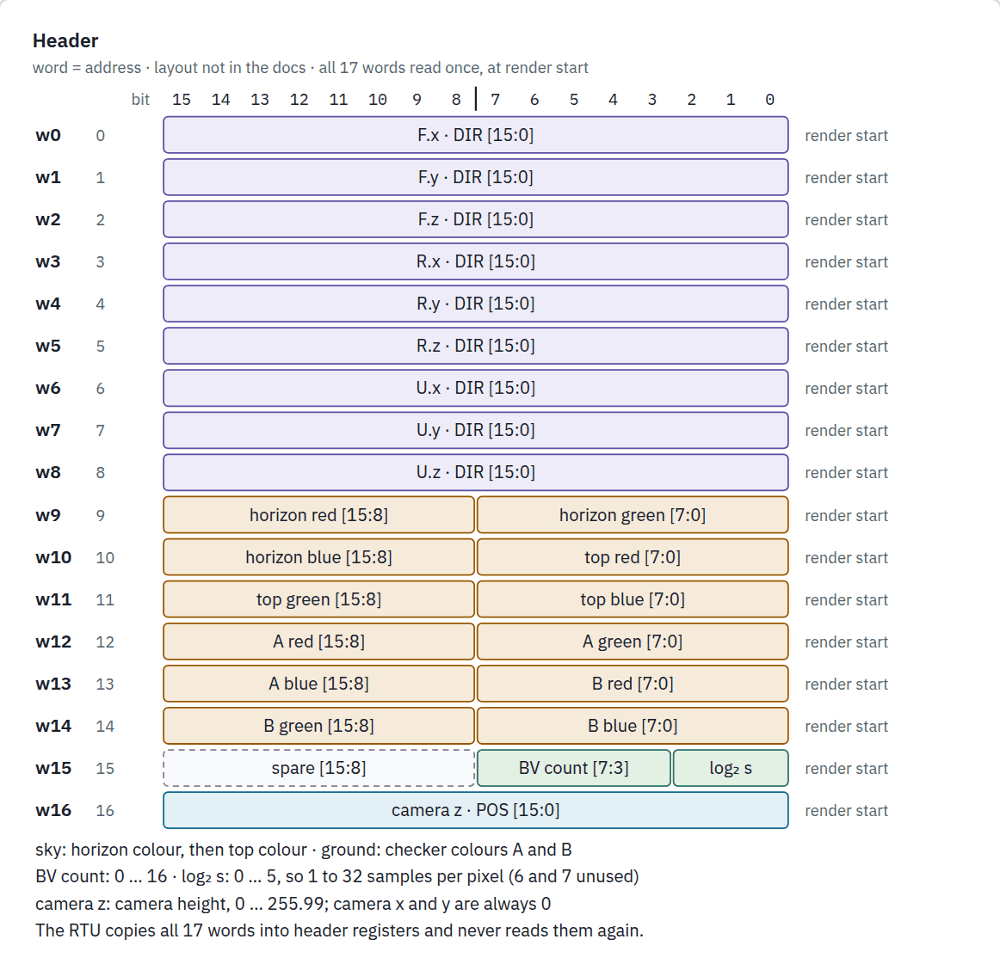

 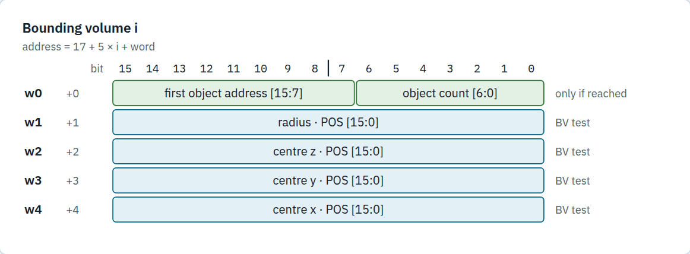

 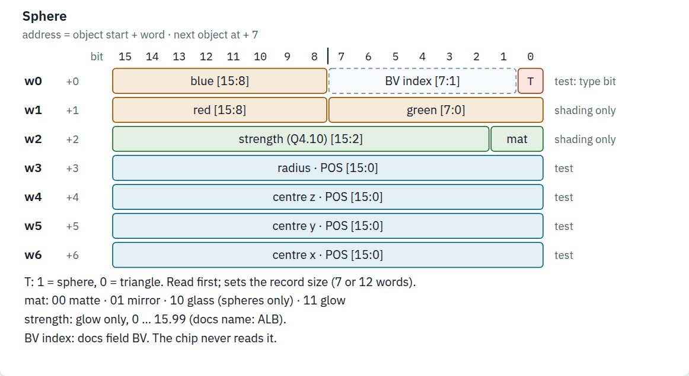

 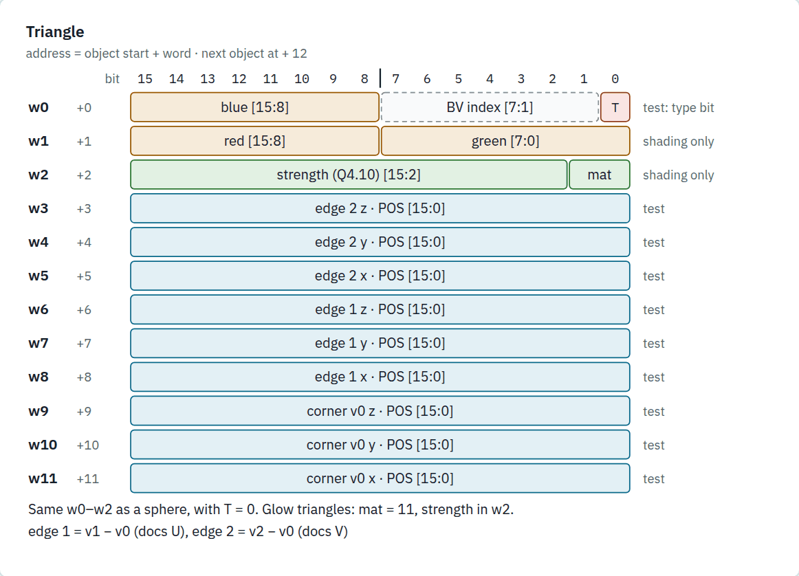

*One row per 16-bit word; bit 15 left, bit 0 right. w0 = lowest address (docs tables list the last word first). Right column = when the RTU reads the word: "render start" = once per render, "test" = every object test, "shading only" = closest hit only. The docs define no header: this header layout is assumed.*

## Level 2: Inside the RTU

 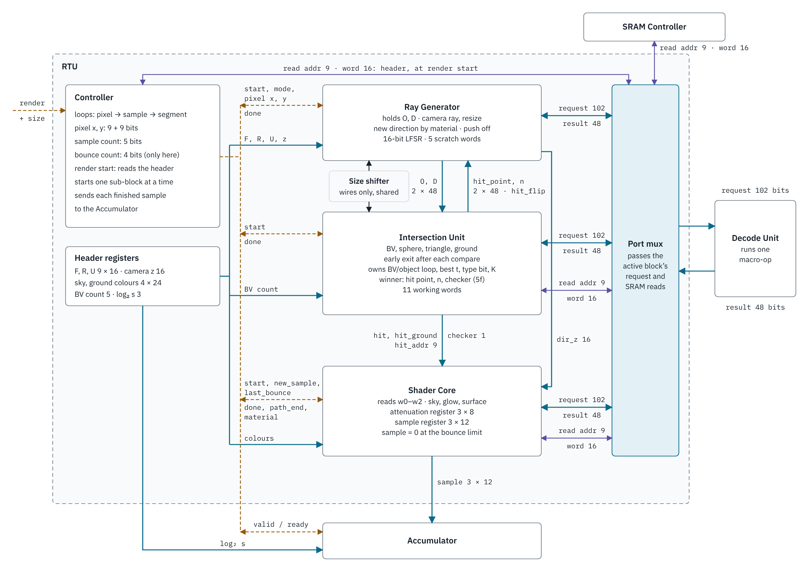

Level 2. The four sub-blocks of the RTU, the wires between them, the port mux and the header registers.

The Controller runs the pixel, sample and bounce loops and starts one sub-block at a time. The Intersection Unit runs the bounding-volume and object loops. Each sub-block owns its state, builds its own 102-bit request and reads its own results. A mux passes the request, and SRAM reads of the active sub-block. Each sub-block holds its data outputs from done until its next start, and other blocks read them on wires; done, req_valid and sram_rd are pulses.

| Register | Bits | Written by | Read by |
|----|----|----|----|
| O · D | 3 × 16 POS · 3 × 16 DIR | Ray Generator | Intersection Unit, Ray Generator; Shader Core (dir_z = D_z) |
| hit · hit_ground · hit_addr · checker | 1 · 1 · 9 · 1 | Intersection Unit | Shader Core |
| hit_point · n · hit_flip | 3 × 16 POS · 3 × 16 DIR · 1 | Intersection Unit (winner) | Ray Generator |
| best t · type bit · K · bv_addr · i (BV number) · obj_addr · objects left | 16 · 1 · 5 · 9 · 5 · 9 · 7 | Intersection Unit | Intersection Unit |
| working words (also hold hit_point, n) | 11 × 16 (estimate) | Intersection Unit | Intersection Unit |
| scratch (matte φ, ρ; glass) | 5 × 16 | Ray Generator | Ray Generator |
| material · path_end | 2 · 1 | Shader Core | Controller |
| attenuation · sample | 3 × 8 · 3 × 12 | Shader Core | Shader Core, Accumulator |
| header registers: F, R, U · camera z · sky, ground colours · BV count, log₂ s | 9 × 16 · 16 · 4 × 24 · 5 + 3 | Controller (render start) | Ray Generator, Intersection Unit (BV count), Shader Core, Accumulator (log₂ s) |
| pixel x, y · sample · bounce | 9 + 9 · 5 · 4 | Controller | Controller; Ray Generator (pixel x, y); Shader Core (last_bounce, new_sample) |

 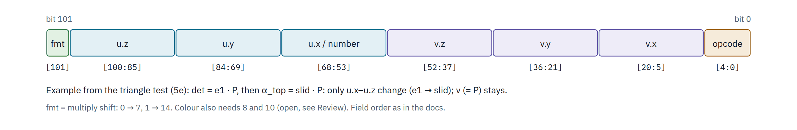

Request, 102 bits: fmt, the 6 number fields and the opcode. Each sub-block builds it from its own words and holds it until the Decode Unit takes it.

fmt = 0: shift output of multiplier by 7

shift input into CORDIC by 7, then shift by 7 when leaving

fmt = 1: shift output of multiplier by 14

shift input into CORDIC by 14, then shift by 14 when leaving

### Which SRAM words fill which registers

**Header.** Read once when RENDER arrives: 17 words, 2 cycles each (17 × 2 = 34 cycles in all). Not read again during the render.

| Header words | Hold | Header register |
|----|----|----|
| w0–w2 | F (x, y, z) | F: 3 × 16 DIR |
| w3–w5 | R | R: 3 × 16 DIR |
| w6–w8 | U | U: 3 × 16 DIR |
| w9–w11 | sky: horizon colour, top colour | sky colours: 2 × 24 |
| w12–w14 | ground: checker colours A, B | ground colours: 2 × 24 |
| w15 | BV count \[7:3\], log₂ s \[2:0\] | BV count: 5 bits · log₂ s: 3 bits |
| w16 | camera z | camera z: 16 POS |

**Bounding volume i.** Its record starts at 17 + 5 × i; the RTU keeps that address in bv_addr and adds 5 for the next BV. Step-by-step example: 5c.

| BV word | Holds | Goes to | When |
|----|----|----|----|
| w1 | radius | leading-one finder → K; radius shifted by K → request u.x and v.x (for r²) | every BV test |
| w2, w3, w4 | centre z, y, x | request u.z, u.y, u.x (for C − O) | every BV test |
| w0 | first object address \[15:7\], object count \[6:0\] | obj_addr, obj_left | only if the ray reaches the BV |

## Level 3: Render loops and one sample

 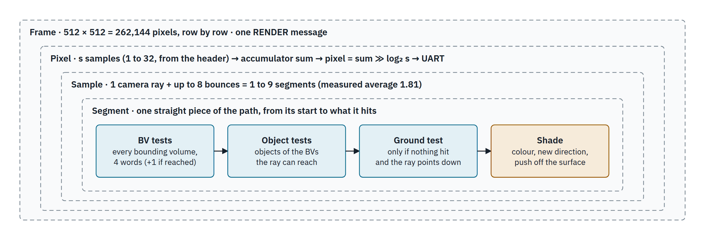

*Level 3a. One 512 × 512 frame at 32 samples: 262,144 × 32 = 8,388,608 samples × 1.809 = 15.2 million segments. At 8 samples: 2,097,152 samples × 1.810 = 3.80 million segments.*


\
*Level 3b. One sample, from the camera ray to the sample colour. Level 5 opens each box.*

## Level 4: One segment

 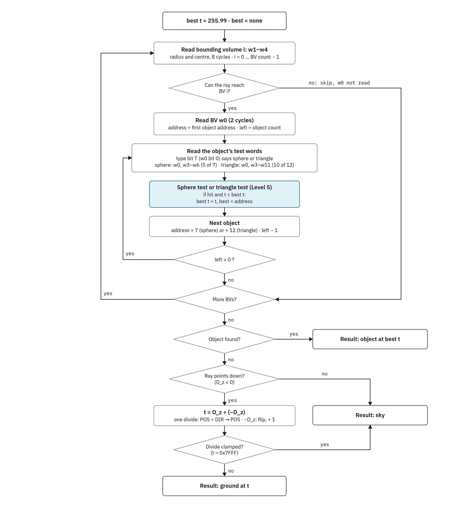

*Level 4. One segment: all bounding-volume tests, the object tests of reached BVs, then the ground.*

A skipped bounding volume costs no object reads: w0 is read only if the BV is reached. Colour words are read only for the closest hit. The ground is tested only if no object was hit. This gives the right answer as long as every object sits at z ≥ 0: along a ray that goes down, an object point at z ≥ 0 always comes before the ground at z = 0.

## Level 5: The calculations of one segment

| Example setup | Value |
|----|----|
| Scene | the objects of the demo scene (sim/scene_demo.txt): 6 spheres, 18 triangles (a box of 12, a pyramid of 4, a glowing square of 2), 4 bounding volumes, ground at z = 0 |
| Camera | (0, 0, 16), turned 45° from +x toward +y, tilted 12° down, field of view 90°, 512 × 512 image. The file's own camera line puts the camera at (5, 5, 12); to repeat these examples, change it to camera 0 0 16 45 -12 90. The frame measurements on this page use the file as it is. |
| Main example | pixel (302, 248): camera ray hits the red matte sphere, bounces once, ends at the sky |
| Numbers | 16-bit values from the fixed-point model (the same maths as the sim) |

### 5a · Camera ray

* Does: Makes the first segment of a sample: start O and length-1 direction D through one point of one pixel.
* Block · when: Ray Generator; triangle n: Intersection Unit · 0.985 per segment
* In: pixel x, y (9 bits each); 12 LFSR bits; F, R, U, camera z (header registers)
* Out: O = (0, 0, camera z), D. The Controller sets bounce = 0.

A screen of 512 × 512 pixels sits in front of the camera. F points to its centre, R from the centre to the right edge, U from the centre to the top edge. A screen point is F + a × R + b × U, with a from −1 (left) to +1 (right) and b from +1 (top) to −1 (bottom). D points through it.

 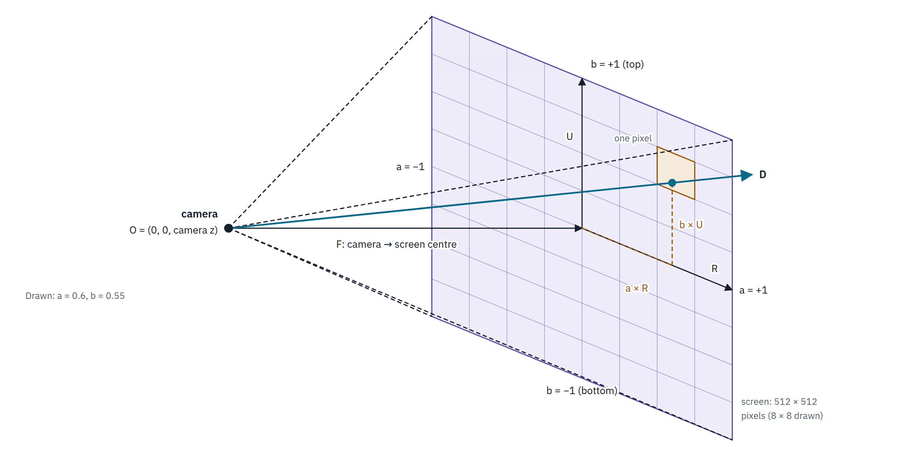

*The laptop stores F, R and U in the header (w0–w8). F has length 1. R and U have length tan(field of view ÷ 2), so 90° gives |R| = |U| = tan 45° = 1. The field of view must be 90° or less (the sim checks this), which keeps F + a × R + b × U inside DIR.*

The laptop computes F, R and U once, so the chip needs no sine or cosine here. 6 random bits of jitter move each sample to a different point inside the pixel; the average smooths edges.


 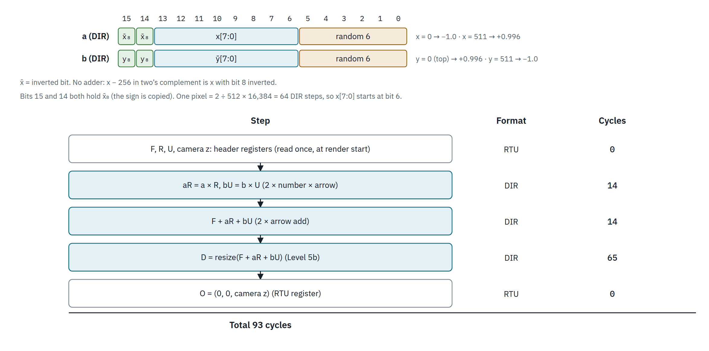

*Camera ray: bit wiring of a and b (top) and the macro-ops with their cycles (bottom).*

| Step | Pixel (302, 248), jitter 27 and 20 |
|----|----|
| a, b | a = (46 × 64 + 27) ÷ 16384 = 0.181 · b = (7 × 64 + 20) ÷ 16384 = 0.029 |
| F, R, U | (0.692, 0.692, −0.208) · (0.707, −0.707, 0) · (0.147, 0.147, 0.978) |
| F + a × R + b × U | (0.824, 0.568, −0.180), length 1.017 |
| D | (0.811, 0.558, −0.177); O = (0, 0, 16) |

### 5b · Resize to length 1

* Does: Scales an arrow to length 1; direction unchanged.
* Block · when: Ray Generator; triangle n: block not decided yet · 0.985 per segment
* In · out: any arrow (DIR or POS) · same direction, length 1, DIR


The RTU first shifts all 3 parts by the same amount, so that the largest part is 0.5 … 1 when read as DIR. The shift also turns a POS arrow into DIR. The length is then 0.5 … 1.73 (√3), so 1 ÷ length is 0.58 … 2. DIR holds up to 1.99994, so a 2 clamps; the result is then half a step short, which is too small to matter.

Then the RTU sends one macro-op, M_NORM. It uses three kinds of micro-op: MAG(a, b) = √(a² + b²), the length of a 2-part arrow; RECP(a) = 1 ÷ a, the reciprocal; and MUL, a multiply. m = MAG(x, y), length = MAG(m, z), inv = RECP(length), then x × inv, y × inv and z × inv. If all parts are 0, the leading-one finder finds no 1; the matte bounce uses this (5g).

 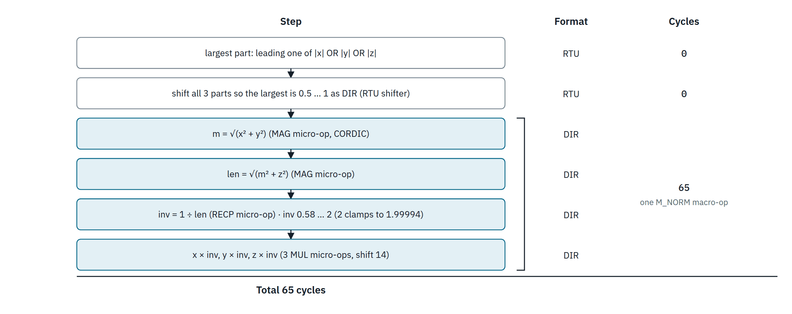


*Resize: the RTU shift, then one M_NORM macro-op (two lengths, one reciprocal, three multiplies).*

| Input | Shift | Length | 1 ÷ length | Result |
|----|----|----|----|----|
| camera ray (0.824, 0.568, −0.180) | none | 1.017 | 0.984 | (0.811, 0.558, −0.177) |
| matte n + r (−1.202, 0.315, 0.992) | right 1 → (−0.601, 0.158, 0.496) | 0.795 | 1.258 | (−0.756, 0.198, 0.624) |
| triangle e1 × e2 (0, −22.5, 12.5) POS | left 2, read as DIR → (0, −0.703, 0.391) | 0.804 | 1.243 | (0, −0.874, 0.486) |

### 5c · Bounding volume test

* Does: Decides if the ray can touch a bounding volume (BV). If not, every object inside it is skipped.
* Block · when: Intersection Unit · every segment, once per BV (4 in the demo scene, up to 16)
* In · out: O, D, centre C, radius r (BV words w1–w4) · reach (then read w0, test the objects) or skip

One BV test (at most 76 cycles) can skip every object inside it; in the demo scene 3.38 of 4 BVs are skipped per segment.

to_centre = C − O is the arrow from the ray start to the centre. along = to_centre · D is the distance along the ray to M, the ray point closest to C (this needs |D| = 1). M = O + along × D, so offset = M − C = along × D − (C − O) = along × D − to_centre. |offset| is the closest distance between the ray and C.

 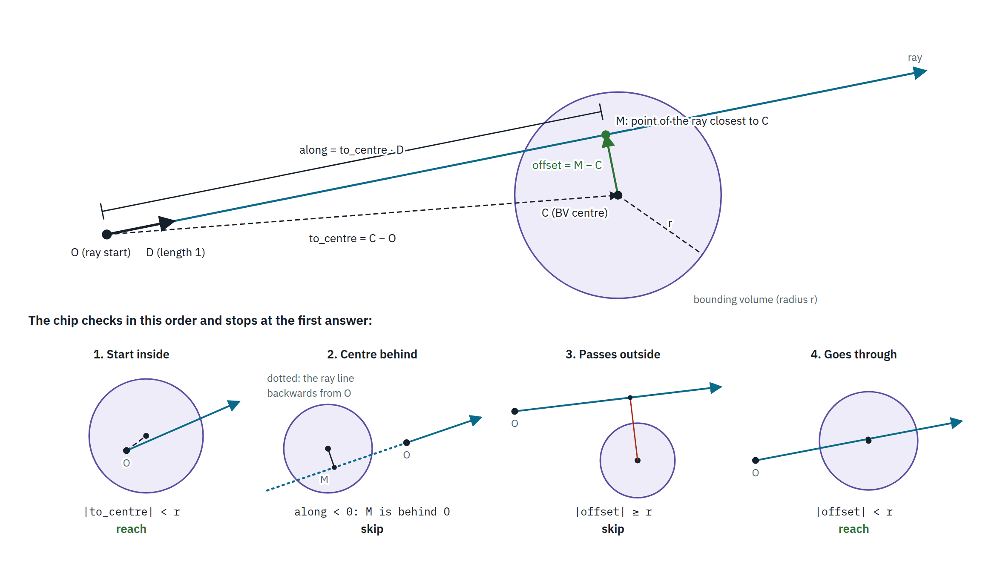

*Top: the three numbers. Bottom: the four outcomes. Green = reach (test the objects), black = skip.*


1. |to_centre| < r: the ray starts inside → reach. Every bounce starts inside its own BV.
2. along < 0: the centre is behind the start, and the start is outside. Moving along the ray only takes the ray farther from C → skip.
3. |offset| < r → reach, else skip.

Squares are compared after the K shift (5d explains K). A square above 256 clamps to 255.99. The compare still gives the right answer, because r_s² is at most 256.

 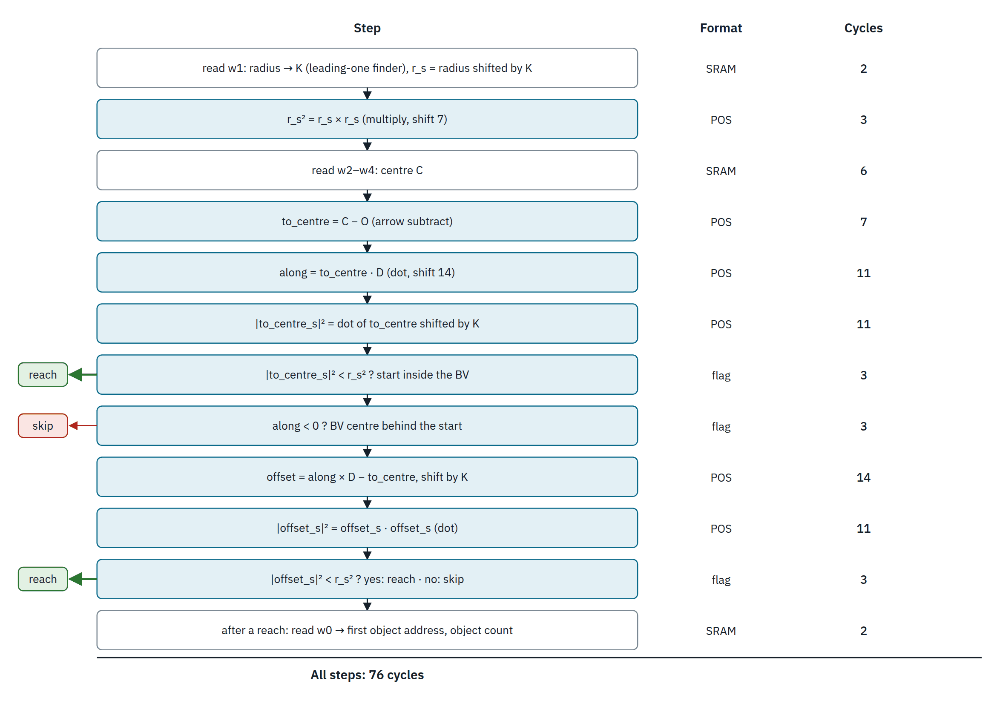

*Bounding volume test: macro-ops in the order the chip runs them. The side labels show where the test can stop early.*

| Case | Numbers | Result |
|----|----|----|
| camera ray, BV 0: C = (28, 23, 6), r = 16.74 | \|to_centre\| = \|(28, 23, −10)\| = 37.6 > r · along = 37.31 > 0 · offset = (2.24, −2.17, 3.40), length 4.61 < r | **reach** |
| camera ray, BV 2: C = (35, 57, 5), r = 8.71 | along = 62.13 > 0 · offset = (15.36, −22.31, 0), length 27.1 > r | skip |
| bounce, BV 0 | O = (28.16, 19.40, 9.87): \|to_centre\| = \|(−0.16, 3.60, −3.87)\| = 5.29 < r | **reach** (start inside) |
| bounce, BV 1: C = (56.5, 35, 10), r = 19.69 | \|to_centre\| = 32.3 > r · D = (−0.756, 0.198, 0.624): along = −18.25 < 0 | skip (behind) |

### BV 0 for the camera ray, step by step

Pixel (302, 248): O = (0, 0, 16), D = (0.811, 0.558, −0.177). BV 0 is words 17–21. ≫ 1 = the size shifter halves a number (K = 1).

| # | What the RTU does | SRAM word read | Request u | Request v | Result | Goes to | Cycles |
|----|----|----|----|----|----|----|----|
| 1 | Read the radius. The leading-one finder picks K = 1 (5d), so the size shifter halves it. | w1 at 17 + 1 = 18 | — | — | r = 16.74 → r_s = 8.375 | u.x and v.x | 2 |
| 2 | Square the radius (M_MUL, shift 7). | — | u.x = 8.375 | v.x = 8.375 | r_s² = 70.14 | scratch | 3 |
| 3 | Read the centre, one word per field. | w2, w3, w4 at 19, 20, 21 | u = C = (28, 23, 6) | v ← O = (0, 0, 16), from the ray state | — | request | 6 |
| 4 | Arrow from the ray start to the centre (M_VSUB). | — | C | O | to_centre = (28, 23, −10) | scratch and u | 7 |
| 5 | How far along the ray the centre is (M_DOT, shift 14). | — | to_centre | v ← D = (0.811, 0.558, −0.177) | along = 37.31 | scratch | 11 |
| 6 | Squared distance from the start to the centre, after the K shift (M_DOT, shift 7). | — | to_centre ≫ 1 = (14, 11.5, −5) | the same as u | 14² + 11.5² + 5² = 353 is above 256: clamps to 255.99 | next request | 11 |
| 7 | Does the ray start inside? (M_LT) | — | u.x = 255.99 | v.x = r_s² = 70.14 | no | flag | 3 |
| 8 | Is the centre behind the start? (M_LT with 0) | — | u.x = along = 37.31 | v.x = 0 | no | flag | 3 |
| 9 | Point of the ray closest to C, measured from O (M_SCAL_VEC). | — | u.x = along | v = D | along × D = (30.24, 20.83, −6.60) | u | 7 |
| 10 | offset = along × D − to_centre (M_VSUB). The size shifter halves it on its way into the next request. | — | along × D | to_centre | offset = (2.24, −2.17, 3.40) → offset_s = (1.13, −1.09, 1.70) | u and v | 7 |
| 11 | Squared closest distance (M_DOT, shift 7). | — | offset_s | offset_s | \|offset_s\|² = 5.34 | next request | 11 |
| 12 | Is the ray closer to C than the radius? (M_LT) | — | u.x = 5.34 | v.x = 70.14 | yes: **reach** | flag | 3 |
| 13 | Read w0: where this BV's objects are. | w0 at 17 + 0 = 17 | — | — | 0x1284: first object at 37, 4 objects | obj_addr = 37, obj_left = 4 | 2 |
|    | **Total** |    |    |    |    |    | **76** |

If step 12 says no (BV 2 here: |offset_s|² = 255.99 ≥ 75.88), the BV is skipped after 74 cycles: w0 is not read, and the RTU moves to the next BV record (address + 5).

**The BV test shares the to_centre, along and offset steps with the sphere test (5d), but since it only needs to find whether or not there was a collision, it doesn't need a square root, making it computationally cheaper.**

### 5d · Sphere test

* Does: Finds the distance t to the first point where the ray touches one sphere.
* Block · when: Intersection Unit · every sphere of a reached BV (2.02 per segment)
* In · out: O, D, C, r (w3–w6) · miss or t; the smallest t (best t), its address and its test values are kept

Same to_centre, along and offset as 5c. |offset| ≥ r → miss. Otherwise the ray crosses the sphere half a chord before M and half a chord after M: half = √(r² − |offset|²). The entry point is at t = along − half. If t ≤ 0.0156 (2 POS steps), the entry point is not in front of the start. Then either the start is inside the sphere (glass), or the whole sphere is behind the start. The test tries the exit point, t = along + half. If that is also ≤ 0.0156, the sphere is behind the start: miss.

 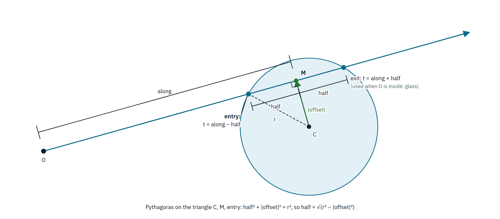


*The ray enters the sphere half a chord before M and leaves half a chord after it.*

**K, the size shift.** The test squares two numbers, |offset|² and r². POS stops at 256, so a sphere with r = 20 would give r² = 400 and clamp. A small sphere has the opposite problem: r = 1.5 gives r² = 2.25, and POS has only 7 bits after the point, so few correct bits are left. So before squaring, the RTU scales the sphere by a power of 2 so that its radius is 8 up to 16; then r² is 64 up to 256. A power-of-2 scale is a shift, so it costs 0 cycles. K is that shift: K > 0 shifts right (÷ 2^K), K < 0 shifts left (× 2^−K).

To pick K, the leading-one finder looks at the radius as a raw number (raw = r × 128) and finds its highest 1 bit. Every radius from 8 up to 16 has raw 1,024 … 2,047, whose highest 1 is bit 10.

**K = (highest 1 bit of the raw radius) − 10. After the shift, the radius is 8 up to 16.**

| Radius r | raw = r × 128 | raw in binary | Highest 1 bit | K = bit − 10 | Shift | r_s | r_s² |
|----|----|----|----|----|----|----|----|
| 6 (red sphere) | 768 | 0000 0011 0000 0000 | 9 | −1 | left 1: × 2 | 12 | 144 |
| 16.74 (BV 0) | 2,143 | 0000 1000 0101 1111 | 11 | +1 | right 1: ÷ 2 | 8.375 | 70.14 |
| 1.5 | 192 | 0000 0000 1100 0000 | 7 | −3 | left 3: × 8 | 12 | 144 |
| 40 | 5,120 | 0001 0100 0000 0000 | 12 | +2 | right 2: ÷ 4 | 10 | 100 |

The offset is shifted by the same K, so |offset_s|² < r_s² gives the same answer as |offset|² < r². half comes out scaled and is shifted back by K.

 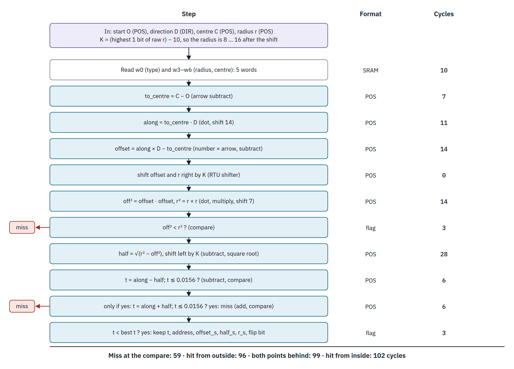

*Sphere test: macro-ops in order, with the number format of each result and its cycles.*

| Step | Red sphere: C = (32, 22, 6), r = 6 |
|----|----|
| K | r = 6: K = −1 (table above), so r_s = 12 and r_s² = 144 |
| to_centre, along | (32, 22, −10) · 32 × 0.811 + 22 × 0.558 + 10 × 0.177 = 39.99 |
| offset | (0.414, 0.328, 2.922); × 2 → (0.828, 0.656, 5.844), square 35.27 < 144 → crosses |
| half, t | √(144 − 35.27) = 10.43, ÷ 2 = 5.22 · t = 39.99 − 5.22 = **34.77** |
| other spheres | BV 0: 3 misses; BV 1: mirror sphere hit at 64.35, farther |

### 5e · Triangle test

* Does: Finds the distance t where the ray crosses one triangle.
* Block · when: Intersection Unit · every triangle of a reached BV (0.61 per segment)
* In · out: O, D, corner v0, edges e1 = v1 − v0, e2 = v2 − v0 (w3–w11) · miss or t

Points of the triangle's plane are v0 + α × e1 + β × e2. α and β are the triangle coordinates of the point (many books call them u and v; on this page u and v are the request fields). A point is inside the triangle when α ≥ 0, β ≥ 0 and α + β ≤ 1. The test (Möller–Trumbore, docs) finds α and β where the ray crosses the plane, and it stops at the first failed check.

 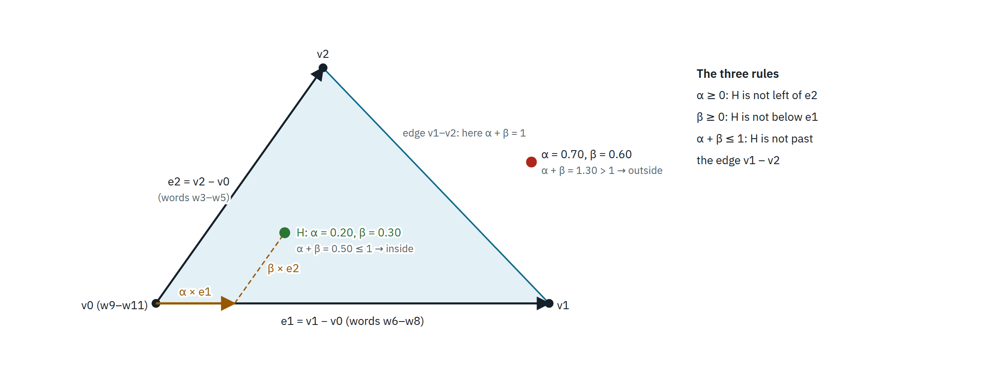

*The test finds α and β of the point H where the ray crosses the triangle's plane, then applies the three rules.*

**K for a triangle.** The test multiplies edge parts with each other and with slid (defined in stage 1 below). Each result adds two or three such products and must stay below 256. So the RTU scales the triangle by a power of 2 until its largest edge part is 4 up to 8 (raw 512 … 1,023, highest 1 bit = 9). An edge is then at most 8 × √3 = 13.9 long.

**K = (highest 1 bit of the largest raw edge part) − 9. After the shift, the largest edge part is 4 up to 8.**

Example: the pyramid face, one of the 4 pyramid triangles of the demo scene (used below). Its largest edge part is 10, in e1 = (10, 0, 0). Step by step:


1. raw = 10 × 128 = 1,280 = 0000 0101 0000 0000.
2. The highest 1 is bit 10, so K = 10 − 9 = 1.
3. K = 1 halves the edges: e1_s = (5, 0, 0), e2_s = (2.5, 2.5, 4.5). The largest part is now 5.

**4 stages of triangle test:**

The intersection unit needs to preserve several registers during triangle computation so it can exit early if a shape is missed.

 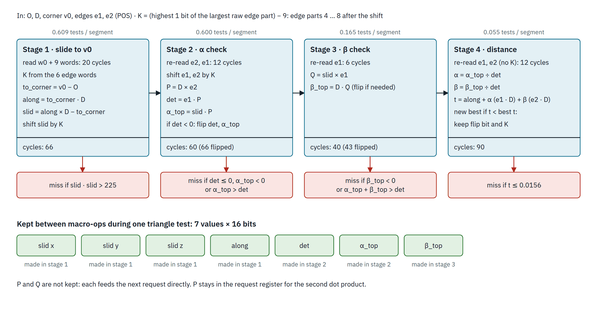

*Triangle test: the four stages, how often each is reached (sim, demo scene), and the 7 values kept between macro-ops.*

Average per triangle test, from the stage rates: 66 + (0.600 ÷ 0.609) × 60 + (0.165 ÷ 0.609) × 40 + (0.055 ÷ 0.609) × 90 = 66 + 59.1 + 10.8 + 8.1 = 144 cycles. This is for the front side; a flipped triangle adds 6 cycles in stage 2 and 3 cycles in stage 3.

| Stage | Pixel (132, 264): D = (0.311, 0.925, −0.216) hits the pyramid face v0 = (12, 48, 0), e1 = (10, 0, 0), e2 = (5, 5, 9); K = 1 (halve) | Result |
|----|----|----|
| 1 | to_corner = (12, 48, −16), along = 51.61, slid = (4.06, −0.24, 4.84), slid_s = slid ÷ 2, \|slid_s\|² = 10.0 | 10.0 ≤ 225: go on |
| 2 | P = D × e2_s = (4.70, −1.94, −1.53), det = 23.52, α_top = 6.07 | 0 ≤ 6.07 ≤ 23.52 |
| 3 | Q = slid_s × e1_s = (0, 12.11, 0.59), β_top = 11.08 | 6.07 + 11.08 = 17.15 ≤ 23.52 |
| 4 | α = 6.07 ÷ 23.52 = 0.258, β = 11.08 ÷ 23.52 = 0.471, e1 · D = 3.11, e2 · D = 4.23, t = 51.61 + 0.258 × 3.11 + 0.471 × 4.23 | **t = 54.41** |

### 5f · After the search: hit point and out-arrow

* Does: For the closest hit only: hit point and out-arrow n; the Shader Core updates the attenuation.
* Block · when: Ray Generator (hit point), Shader Core (colour words, attenuation); n: block not decided yet · every segment that ends on a surface (0.45 per segment)
* In · out: hit kind, best t, best address, kept test values, O, D · hit point (into O), n, attenuation

Why this step exists. The search (5c–5e) finds only which object is closest and how far away it is. The next segment starts at H, the ground colour depends on H, and the new direction needs n. The chip computes them once, for the winner only; doing it for every object tested would waste cycles on objects that lose.

The search keeps best t, best address, hit, hit_ground, a type bit, a flip bit and, for a triangle, K. A closer hit overwrites them. For the winner:


1. H = O + t × D.
2. Sphere: read the centre C and the radius r (w3–w6) again, then n = (H − C) ÷ r. H − C has length exactly r, so 3 divides give length 1. Ray inside glass (flip bit 1): n = (C − H) ÷ r, which faces the ray.
3. Triangle: read the edges (w3–w8) into the request fields u and v, shifted by the kept K, then n = resize(u × v) (table below).
4. Ground: n = (0, 0, 1); checker = bit 9 of H.x XOR bit 9 of H.y (1 = colour A, 0 = colour B).

Sky: no H and no n. The winner's test does not run a second time. n always faces the ray, so the Ray Generator does not flip it; it uses the flip bit only to pick η on glass.

Triangle n faces the ray. The Intersection Unit loads the 6 edge words one at a time, so the flip bit can pick u or v for each. Swapping the two inputs of a cross product turns the result around, so M_CROSS and the Decode do not change.

Why the flip bit is the right choice: det = e1 · (D × e2) = −D · (e1 × e2). det < 0 (flip bit 1) means e1 × e2 points along D, away from the ray start, so n must be turned around.

 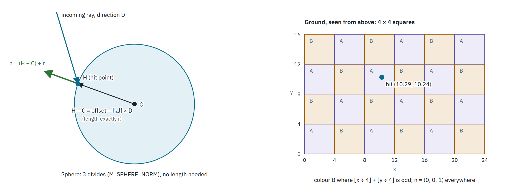

*Left: why the sphere out-arrow needs no length calculation. Right: the ground checker.*

| When | Value | Bits | Used by |
|----|----|----|----|
| search | best t · best address · hit kind | 16 · 9 · 2 | Intersection Unit; Ray Generator (hit point); Shader Core (address); Controller |
| search, best is a sphere | offset_s · half_s · r_s · flip bit (ray starts inside) | 48 · 16 · 16 · 1 | the block that makes n; Ray Generator (glass) |
| search, best is a triangle | flip bit (back side) · K | 1 · 5 | the block that makes n |
| winner only | hit point (in O, made by the Ray Generator) · n | 48 · 48 | Ray Generator; Shader Core (checker bits) |

**Triangle n faces the ray.** The RTU loads the 6 edge words into the request one at a time anyway, so it can write each word into u or v. The flip bit picks which. Swapping the two inputs of a cross product turns the result around, so M_CROSS and the Decode do not change.

| SRAM word | Holds | Front side (flip bit 0) | Back side (flip bit 1) |
|----|----|----|----|
| w3, w4, w5 | e2 z, y, x | v.z, v.y, v.x | u.z, u.y, u.x |
| w6, w7, w8 | e1 z, y, x | u.z, u.y, u.x | v.z, v.y, v.x |
| M_CROSS gives u × v |    | e1 × e2 | e2 × e1 = −(e1 × e2) |

Why the flip bit is the right choice: det = e1 · (D × e2) = −D · (e1 × e2). det < 0 (flip bit 1) means e1 × e2 points along D, away from the ray start, so n must be turned around. Pyramid face: det = 23.52 > 0, flip bit 0, request u = e1_s = (5, 0, 0), request v = e2_s = (2.5, 2.5, 4.5), u × v = (0, −22.5, 12.5), n = (0, −0.874, 0.486), n · D = −0.914 < 0. Hit from behind it would be u × v = e2_s × e1_s = (0, 22.5, −12.5).

 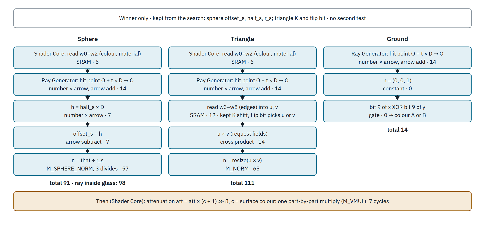

*After the search: steps and cycles per surface.*

| Surface | Numbers |
|----|----|
| red sphere | kept: offset_s = (0.828, 0.656, 5.844), half_s = 10.43, r_s = 12 · hit point = (0, 0, 16) + 34.77 × D = (28.19, 19.41, 9.84) · n = (offset_s − 10.43 × D) ÷ 12 = **(−0.635, −0.430, 0.641)** · att = (220, 61, 51) |
| pyramid face | front side (det = 23.52 > 0, flip bit 0), K = 1 · request u = e1_s = (5, 0, 0), request v = e2_s = (2.5, 2.5, 4.5) · n = resize(u × v) = resize((0, −22.5, 12.5)) = (0, −0.874, 0.486) |
| ground, pixel (256, 440) | D = (0.476, 0.474, −0.7405). −D_z (every bit flipped, plus 1) = 0.7405, so t = 16 ÷ 0.7405 = 21.61 → hit point (10.29, 10.24, 0.000) · POS has 7 bits after the point, so bit 9 is worth 2² = 4, and bit 9 of x = ⌊x ÷ 4⌋ mod 2: ⌊10.29 ÷ 4⌋ = 2 and ⌊10.24 ÷ 4⌋ = 2 are even, so 0 XOR 0 = 0 → colour A |

### 5g · New direction

* Does: Picks the next direction from the material, then moves the start off the surface.
* Block · when: Ray Generator · after each surface hit below the bounce limit (0.45 per segment)
* In · out: D, n, material, flip bit (glass: ray inside), LFSR bits · new D, new O; bounce + 1

**Matte:** new D = resize(n + r), r = random length-1 arrow. n + r lies on a radius-1 sphere resting on the surface, so D always leaves the surface and favours directions near n.

**Mirror:** D − 2 (D · n) n.

**Glass:** glass bends light. The index of refraction (IOR) is 1.5 for glass and 1.0 for air. η is the ratio of the two indices: 1 ÷ 1.5 = 0.667 going in, 1.5 going out. cos θ = −(D · n) is the cosine of the angle between the incoming ray and n. 

k = η × (η × (1 − cos²θ)).

If k < 0, no bent ray exists (total internal reflection), so the ray reflects. Otherwise the ray reflects with the chance share = 0.04 + 0.96 (1 − cos θ)⁵ (Schlick's formula: 0.04 = ((1.5 − 1) ÷ (1.5 + 1))² is the head-on reflection of glass, and 0.96 = 1 − 0.04), picked with 8 random bits, and bends in the other cases.

 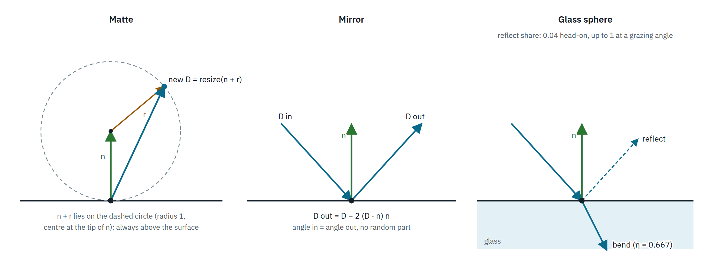

**Random arrow r.** A height z (8 bits) and a heading φ = w × 90° (8 bits), both picked evenly, give every direction the same chance; 2 sign bits pick the quarter turn. ρ = √(1 − z²) is the radius of the circle at height z on a radius-1 sphere. r = (±ρ cos φ, ±ρ sin φ, z), with sin φ = cos(φ − 90°). φ in 0 … 90° keeps both M_COS inputs within the CORDIC range (±99.8°).

**What M_COS does.** It takes an angle in radians as a DIR number (0.920 means 0.920 rad = 52.7°) and returns the x of the point at that angle on a circle of radius 1: cos 52.7° = 0.605. The y of that point is sin φ = 0.796. The matte bounce is the only user of cos; the camera needs none, because the laptop computes F, R and U. 

 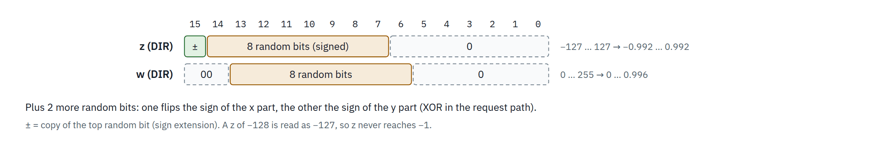

*Matte random arrow: bit wiring from the LFSR. No arithmetic.*

**Push off:** O = hit + 0.031 × n (glass that bends: − 0.031 × n), so rounding cannot re-hit the surface at t ≈ 0.

 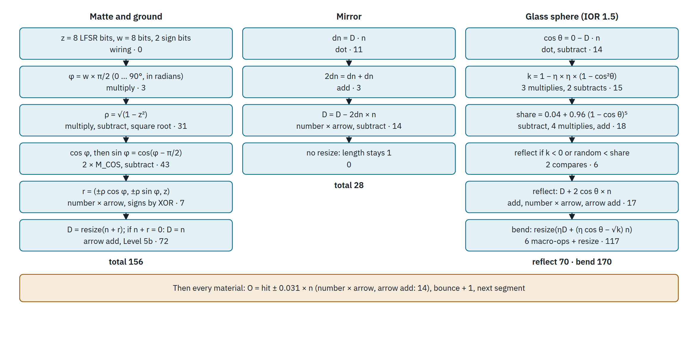

*New direction: macro-ops and cycles per material.*

### 5h · Colour

* Does: Tracks the light the path still carries, then makes the sample colour.
* Block · when: Shader Core · attenuation at each surface; sample at the sky or a glow object
* In · out: surface colour, sky colours (header registers), D_z, glow strength · sample, 12 bits per colour

c is the surface colour, 8 bits per colour: the object colour, or checker colour A or B on the ground. att = att × (c + 1) ≫ 8 at each surface. 

Sky: L = horizon + (top − horizon) × D_z (D_z < 0 → 0), sample = (att + 1) × L ≫ 8. 

Glow: sample = ((att + 1) × c ≫ 8) × strength ≫ 10, up to 4,080 (12 bits). 

 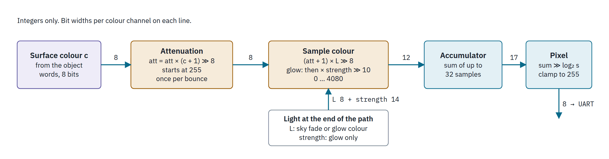

*Colour path: bit width per colour channel on each line.*

| Step (red matte sphere, then sky at D_z = 0.624) | Red | Green | Blue |
|----|----|----|----|
| surface colour c | 220 | 60 | 50 |
| attenuation at start | 255 | 255 | 255 |
| att × (c + 1) ≫ 8, rounded | 255 × 221 ≫ 8 = 220 | 255 × 61 ≫ 8 = 61 | 255 × 51 ≫ 8 = 51 |
| sky: horizon + (top − horizon) × D_z | 235 + (−125 × 0.624) = 157 | 240 + (−80 × 0.624) = 190 | 255 + 0 = 255 |
| sample = (att + 1) × L ≫ 8 | 221 × 157 ≫ 8 = 136 | 62 × 190 ≫ 8 = 46 | 52 × 255 ≫ 8 = 52 |

## Decode Unit/RegFile

 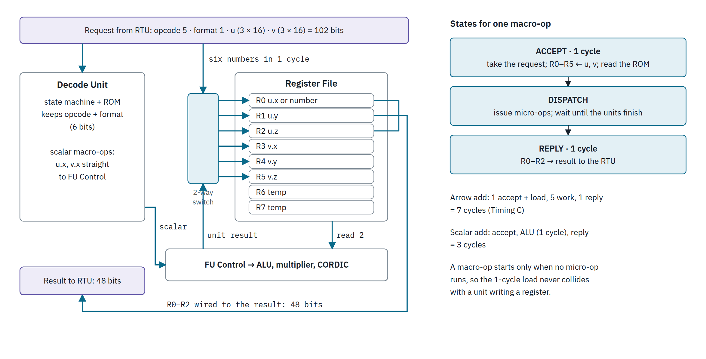

*Decode Unit. u.x, u.y, u.z always go to R0, R1, R2 and v.x, v.y, v.z to R3, R4, R5, so the ROM micro-ops know where every operand is. The 2-way switch feeds each register from the request (in ACCEPT) or from a unit result (in DISPATCH).* 

## Macro-ops and micro-ops: Lists and how they map

Opcodes from docs/encoding/instruction.md, plus M_VMUL (added). Scalar macro-ops go straight to their unit; the micro opcode is the low 4 bits of the macro opcode. Vector macro-ops read their micro-ops from the Decode ROM. Operands always sit in the same registers: u.x, u.y, u.z → R0, R1, R2 and v.x, v.y, v.z → R3, R4, R5.

### Macro-ops

| Opcode | Macro-op  | Does | Operands → registers | Micro-ops in order | Result | Cycles | Used in TinyTracer |
|----|----|----|----|----|----|----|----|
| 00000 | M_ADD | u.x + v.x | u.x, v.x straight to the unit | ADD | unit result | 3 | yes |
| 00001 | M_SUB | u.x − v.x | u.x, v.x straight to the unit | SUB | unit result | 3 | yes |
| 00010 | M_EQ | u.x = v.x | u.x, v.x straight to the unit | EQ | unit result | 3 | no |
| 00011 | M_NE | u.x ≠ v.x | u.x, v.x straight to the unit | NE | unit result | 3 | no |
| 00100 | M_LT | u.x < v.x | u.x, v.x straight to the unit | LT | unit result | 3 | yes: every test |
| 00101 | M_GE | u.x ≥ v.x | u.x, v.x straight to the unit | GE | unit result | 3 | no (= not LT) |
| 00110 | M_MUL | u.x × v.x | u.x, v.x straight to the unit | MUL | unit result | 3 | yes |
| 00111 | M_DIV | u.x ÷ v.x | u.x, v.x straight to the unit | DIV | unit result | 19 | yes: ground t, triangle α, β |
| 01000 | M_SQRT | √u.x | u.x straight to the unit | SQRT | unit result | 25 | yes: half chord, glass, matte |
| 01001 | M_COS | cos u.x | u.x straight to the unit | COS | unit result | 20 | yes: matte, 2 per bounce |
| 01010 | M_RECP | 1 ÷ u.x | u.x straight to the unit | RECP | unit result | 19 | only inside M_NORM |
| 01011 | M_MAG | √(u.x² + v.x²) | u.x, v.x straight to the unit | MAG | unit result | 21 | only inside M_NORM |
| 01100 | M_VADD | u + v | u → R0–R2, v → R3–R5 | ADD R0 ← R0, R3 · ADD R1 ← R1, R4 · ADD R2 ← R2, R5 | R0–R2 | 7 | yes |
| 01101 | M_VSUB | u − v | u → R0–R2, v → R3–R5 | SUB R0 ← R0, R3 · SUB R1 ← R1, R4 · SUB R2 ← R2, R5 | R0–R2 | 7 | yes |
| 01110 | M_SCAL_VEC | u.x × v | u.x (number) → R0, v → R3–R5 | MUL R1 ← R0, R4 · MUL R2 ← R0, R5 · MUL R0 ← R0, R3 | R0–R2 | 7 | yes |
| 01111 | M_DOT | u · v | u → R0–R2, v → R3–R5 | MUL R0 ← R0, R3 · MUL R1 ← R1, R4 · MUL R2 ← R2, R5 · ADD R0 ← R0, R1 · ADD R0 ← R0, R2 | R0 | 11 | yes |
| 10000 | M_CROSS | u × v | u → R0–R2, v → R3–R5 | MUL R6 ← R2, R4 · MUL R2 ← R2, R3 · MUL R4 ← R0, R4 · MUL R3 ← R1, R3 · MUL R1 ← R1, R5 · MUL R5 ← R0, R5 · SUB R0 ← R1, R6 · SUB R1 ← R2, R5 · SUB R2 ← R4, R3 | R0–R2 | 14 | yes: triangle P, Q, n |
| 10001 | M_NORM | u ÷ \|u\| | u → R0–R2 | MAG R3 ← R0, R1 · MAG R3 ← R3, R2 · RECP R3 ← R3 · MUL R0 ← R3, R0 · MUL R1 ← R3, R1 · MUL R2 ← R3, R2 | R0–R2 | 65 | yes: every resize |
| 10010 | M_SPHERE_NORM | v ÷ u.x | u.x (radius) → R0, v → R3–R5 | DIV R1 ← R4, R0 · DIV R2 ← R5, R0 · DIV R0 ← R3, R0 | R0–R2 | 57 | yes: sphere n |
| 10011 (added) | M_VMUL | u ⊙ v, part by part | u → R0–R2, v → R3–R5 | MUL R0 ← R0, R3 · MUL R1 ← R1, R4 · MUL R2 ← R2, R5 | R0–R2 | 7 | yes: colour |

### Micro-ops

RD is the register that a micro-op writes; RS1 and RS2 are the registers it reads. "RD ← RS1 + RS2" means that RD is loaded with the sum of RS1 and RS2.

| Micro opcode | Micro-op | Computes | Unit | Unit opcode | Unit cycles | Used inside |
|----|----|----|----|----|----|----|
| 0000 | ADD | RD ← RS1 + RS2 | ALU | ALU_ADD 000 | 1 | M_ADD, M_VADD, M_DOT |
| 0001 | SUB | RD ← RS1 − RS2 | ALU | ALU_SUB 001 | 1 | M_SUB, M_VSUB, M_CROSS |
| 0010 | EQ | RD ← 1 if RS1 = RS2, else 0 | ALU | ALU_EQ 010 | 1 | M_EQ (unused) |
| 0011 | NE | RD ← 1 if RS1 ≠ RS2, else 0 | ALU | ALU_NE 011 | 1 | M_NE (unused) |
| 0100 | LT | RD ← 1 if RS1 < RS2, else 0 | ALU | ALU_LT 100 | 1 | M_LT |
| 0101 | GE | RD ← 1 if RS1 ≥ RS2, else 0 | ALU | ALU_GE 101 | 1 | M_GE (unused) |
| 0110 | MUL | RD ← RS1 × RS2, shifted back (7 or 14 bits) | multiplier | none | 1 | M_MUL, M_SCAL_VEC, M_DOT, M_CROSS, M_NORM, M_VMUL |
| 0111 | DIV | RD ← (RS1 ≪ 14) ÷ RS2 | CORDIC | CORDIC_DIV 000 | 17 | M_DIV, M_SPHERE_NORM |
| 1000 | SQRT | RD ← √RS1 (RS2 not used) | CORDIC | CORDIC_SQRT 001 | 23 | M_SQRT |
| 1001 | COS | RD ← cos RS1, RS1 in radians (RS2 not used) | CORDIC | CORDIC_COS 010 | 18 | M_COS |
| 1010 | RECP | RD ← 1 ÷ RS1 (RS2 not used) | CORDIC | CORDIC_RECP 011 | 17 | M_RECP, M_NORM |
| 1011 | MAG | RD ← √(RS1² + RS2²) | CORDIC | CORDIC_MAG 100 | 19 | M_MAG, M_NORM |

### Decode ROM

One row per micro-op of a vector macro-op. Scalar macro-ops need no row. Barrier = wait until the earlier micro-ops of this macro-op finish. In M_SCAL_VEC and M_SPHERE_NORM, R0 holds the number, so R0 is written last.

| Row | Macro-op | Micro-op | Barrier | Bits: barrier · RD · RS1 · RS2 · opcode |
|----|----|----|----|----|
| 0 | M_VADD | ADD R0 ← R0, R3 |    | `0 000 000 011 0000` |
| 1 | M_VADD | ADD R1 ← R1, R4 |    | `0 001 001 100 0000` |
| 2 | M_VADD | ADD R2 ← R2, R5 |    | `0 010 010 101 0000` |
| 3 | M_VSUB | SUB R0 ← R0, R3 |    | `0 000 000 011 0001` |
| 4 | M_VSUB | SUB R1 ← R1, R4 |    | `0 001 001 100 0001` |
| 5 | M_VSUB | SUB R2 ← R2, R5 |    | `0 010 010 101 0001` |
| 6 | M_SCAL_VEC | MUL R1 ← R0, R4 |    | `0 001 000 100 0110` |
| 7 | M_SCAL_VEC | MUL R2 ← R0, R5 |    | `0 010 000 101 0110` |
| 8 | M_SCAL_VEC | MUL R0 ← R0, R3 |    | `0 000 000 011 0110` |
| 9 | M_DOT | MUL R0 ← R0, R3 |    | `0 000 000 011 0110` |
| 10 | M_DOT | MUL R1 ← R1, R4 |    | `0 001 001 100 0110` |
| 11 | M_DOT | MUL R2 ← R2, R5 |    | `0 010 010 101 0110` |
| 12 | M_DOT | ADD R0 ← R0, R1 | yes | `1 000 000 001 0000` |
| 13 | M_DOT | ADD R0 ← R0, R2 | yes | `1 000 000 010 0000` |
| 14 | M_CROSS | MUL R6 ← R2, R4 |    | `0 110 010 100 0110` |
| 15 | M_CROSS | MUL R2 ← R2, R3 |    | `0 010 010 011 0110` |
| 16 | M_CROSS | MUL R4 ← R0, R4 |    | `0 100 000 100 0110` |
| 17 | M_CROSS | MUL R3 ← R1, R3 |    | `0 011 001 011 0110` |
| 18 | M_CROSS | MUL R1 ← R1, R5 |    | `0 001 001 101 0110` |
| 19 | M_CROSS | MUL R5 ← R0, R5 |    | `0 101 000 101 0110` |
| 20 | M_CROSS | SUB R0 ← R1, R6 | yes | `1 000 001 110 0001` |
| 21 | M_CROSS | SUB R1 ← R2, R5 |    | `0 001 010 101 0001` |
| 22 | M_CROSS | SUB R2 ← R4, R3 |    | `0 010 100 011 0001` |
| 23 | M_NORM | MAG R3 ← R0, R1 |    | `0 011 000 001 1011` |
| 24 | M_NORM | MAG R3 ← R3, R2 | yes | `1 011 011 010 1011` |
| 25 | M_NORM | RECP R3 ← R3 | yes | `1 011 011 000 1010` |
| 26 | M_NORM | MUL R0 ← R3, R0 | yes | `1 000 011 000 0110` |
| 27 | M_NORM | MUL R1 ← R3, R1 |    | `0 001 011 001 0110` |
| 28 | M_NORM | MUL R2 ← R3, R2 |    | `0 010 011 010 0110` |
| 29 | M_SPHERE_NORM | DIV R1 ← R4, R0 |    | `0 001 100 000 0111` |
| 30 | M_SPHERE_NORM | DIV R2 ← R5, R0 |    | `0 010 101 000 0111` |
| 31 | M_SPHERE_NORM | DIV R0 ← R3, R0 |    | `0 000 011 000 0111` |
| 32 | M_VMUL | MUL R0 ← R0, R3 |    | `0 000 000 011 0110` |
| 33 | M_VMUL | MUL R1 ← R1, R4 |    | `0 001 001 100 0110` |
| 34 | M_VMUL | MUL R2 ← R2, R5 |    | `0 010 010 101 0110` |

### Pending Changes

| Change | Why |
|----|----|
| **New macro-op M_VMUL** | Colour needs part-by-part multiply (attenuation, sample). M_SCAL_VEC uses one number, M_DOT adds the parts. Same shape as M_VADD, with MUL. |
| **Multiply shift select** | 1 bit: shift 7 or 14. Colour uses format 0, then drops result bits (5h). |
| Keep M_COS | Matte heading: cos φ and sin φ = cos(φ − π/2). |
| Drop M_EQ, M_NE, M_GE | Never used. GE = NOT LT. |
| M_RECP, M_MAG | Not used as macro-ops; their micro-ops stay inside M_NORM. |
| No saturation (clamp) flag | The ground test checks t = 0x7FFF with a gate; elsewhere clamping gives the right answer. |

## Timing initialization of one frame

| # | Before the render | Time |
|----|----|----|
| 1 | Reset: every register 0, LFSR = 1. | — |
| 2 | The clock-divider settings b and c are loaded through the I/O Unit inputs clkdiv_ctl and clkdiv_data (docs [io.md](http://io.md)). They set the baud rate (below). | — |
| 3 | The laptop sends the scene: one OBJECT message (5 bytes = 50 bits) per SRAM word, plus a DLE byte (data link escape, 0x03) before each data byte equal to a start byte (0x00 RENDER, 0x01 OBJECT) or 0x03. Demo scene: 295 words. | 295 × 50 bits ÷ 115,200 = 0.13 s, plus the DLE bytes |
| 4 | The laptop sends RENDER (5 bytes, with the image size). | 50 bits ÷ 115,200 = 0.4 ms |
| 5 | The RTU reads the 17 header words into the header registers. | 17 × 2 = 34 cycles = 1.36 µs |

Then the chip renders the pixels one after another, row by row. While the RTU renders a pixel, the I/O Unit sends the one before it to the laptop.

## Proposal: Free compares

A compare macro-op (M_LT) costs 3 cycles: accept, ALU, reply. Many compares only ask if a number is below 0, or above or below a fixed constant. Those need no ALU. A negative number in two's complement has bit 15 (the sign bit) = 1, and the RTU already holds the number (it just came back as a result), so it reads bit 15 directly: a wire, 0 cycles. A compare with a constant is a small gate on the bits. Only compares between two variables (|offset|² < r², t < best t, α_top ≤ det) keep M_LT.

| Compare | Where | Free because |
|----|----|----|
| along < 0 | BV test | bit 15 (the sign bit) of along |
| det < 0 (flip), det ≤ 0, α_top < 0, β_top < 0 | triangle stages 2–3 | sign bit; det = 0 also needs "all bits 0" (one NOR gate) |
| k < 0 | glass | sign bit |
| D_z < 0 | ground check, sky | sign bit |
| t ≤ 0.0156 | sphere, triangle | raw t ≤ 2: the sign bit, or bits 14–2 all 0 and bits 1–0 not both 1 (a gate) |
| \|slid\|² > 225 | triangle stage 1 | raw > 28,800 (225 × 128): a fixed-constant compare, a few gates |

```
7.70 compares with 0 or a constant per segment × 3 cycles = 23.1 cycles
658.1 − 23.1 = 635.0 cycles per segment
32 samples: 15,178,628 segments × 635.0 ÷ 25 MHz = 385.5 s = 6.4 min (now 399.6 s = 6.7 min)
```


\

\
——————— outdated, do not use below ———————


\

\
Presume object data (.stl) has already been deconstructed into its component triangular planes. Organize these triangles into bounding boxes.

### 1. SRAM Initialization (1024 x 8/16-bits)

* **1.1 Header Section**
  * **Trig LUT (CORDIC):** 32-entry LUT rotation table
  * Sky color, ground colour/grid pattern constants
* **1.2 Encoded Scene (BVH Structure)**
  * Usage of multiple spheres as bounding boxes as part of a **Spatial Partition**, which contain:
    * **Bounding Sphere:** stored as Center and radius
    * **Spheres:** Stored as Center and radius
    * **Triangles:** Stored as indexed vertices (Barycentric calculation).

### 2. Primary Computation Loop

#### **A. Initial Pixel/Ray Computation**

* **While** (samples_remaining > 0):

  
  1. **Decrement** samples_remaining.
  2. **Ray Generation:**
     * Generate random jitter using PRBS implemented with LFSR.
     * Compute the vector from the camera through the jittered pixel coordinate on the virtual screen
  3. **Initialize Ray State:** Set current_attenuation = 1.0, total_color = 0.0, bounces_remaining = 8.

#### **B. Path Tracing (Bounce) Loop**

* **While** (bounces_remaining > 0):

  
  1. **Decrement** bounces_remaining.
  2. **Reset Hit State:** closest_t = INFINITY, hit_anything = false.
  3. for each BVH**:**
     * **BB Intersection:** Perform **Kay-Kajiya Slab Method** on the next Bounding Box, or another collision check. 
       * Pre-compute 1/direction to replace division with multiplication.
       * If the bounding volume is intersected:
       * Check each item in BVH. If Collision:

         
         1. **Intersection Test:**
            * **Triangle:** Use Möller–Trumbore (Barycentric) to find distance t.
            * **Sphere:** Use algebraic quadratic solution to find t.
         2. **Compare Distance:** If (t > 0), and it is the smallest t thus far (closest to source):
            * Store the SRAM address of the object, so we can go back and refer to it later
            * Update closest T
     * **Else (No bounding volume Collision):** Skip this BV and move on

\n**C. Shading and Scattering (If hit_anything == true)**


1. **Retrieve Material Data:** Fetch object colour (Albedo) and material type (Emissive, Matte, Metal, or Glass) from SRAM.
2. **Handle Light Sources:**
   * **If material is Emissive: (light source)**
     * total_color = (base colour \* current_attenuation)
     * **Break** (Stop bouncing; this ray has found a light source).
3. **Handle Reflective Surfaces:**
   * **Else (Matte, Metal, or Glass):**
     * Update filter: current_attenuation = (current_attenuation \* base colour) >> 16.
       * This "tints" the light by the object's colour
4. **Scatter Ray:**
   * Generate a new randomized direction:
     * **Glass:** Refracted or reflected direction according to Snell's Law and Schlick approximation.
     * **Matte:** Random scatter direction by adding a random unit vector to the surface normal.
     * **Metal:** Perfect reflection vector
   * Calculate the new Ray origin (Hit Point + bit-shifted epsilon offset to avoid self-intersection).
5. **Re-inject** this new ray back into **Step 2.B** (to start bounce).

#### **D. Miss Handler (If hit_anything == false)**


1. Fetch sky/ground colour based on current ray direction.
2. **Terminal Accumulation:** total_color = (Sky_Color \* current_attenuation).
3. break the loop (no further collisions).

### 3. Post-Processing and Output


1. **Final Register Storage:** Move the accumulated total_color for the sample into a high-precision register.
2. **Sample Averaging:**
   * After all samples are complete, average the pixel values.
     * Use bit-shifting to achieve division for the final average pixel colour
3. Send the resulting pixel data to the host computer
4. Increment pixel coordinate and return to Step 2 until the frame is complete.